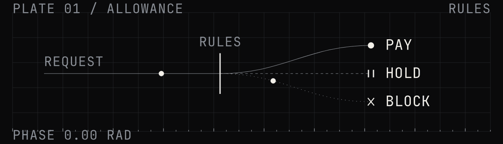
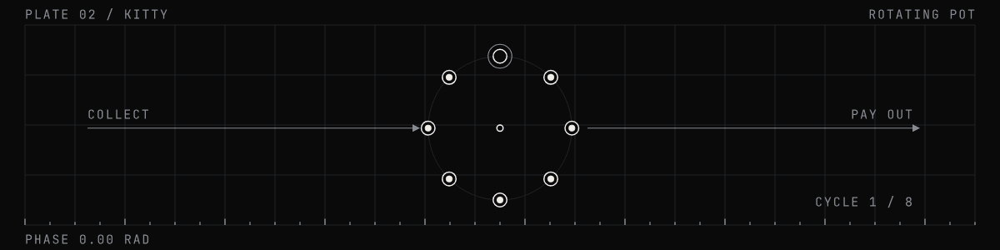
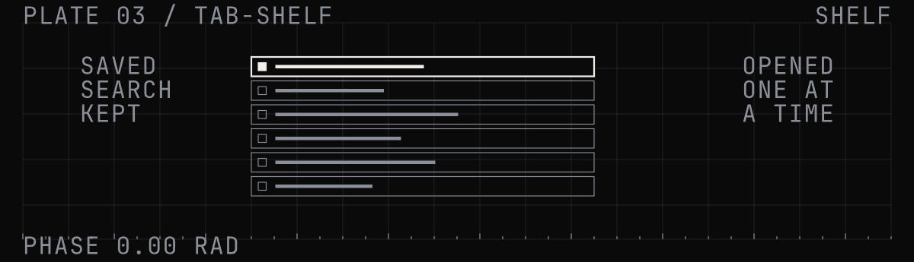
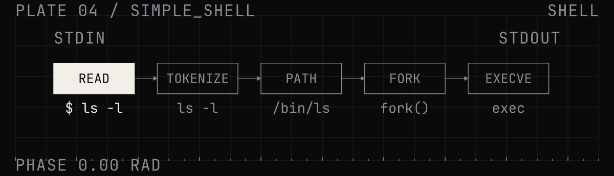
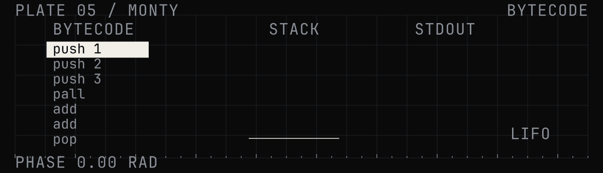
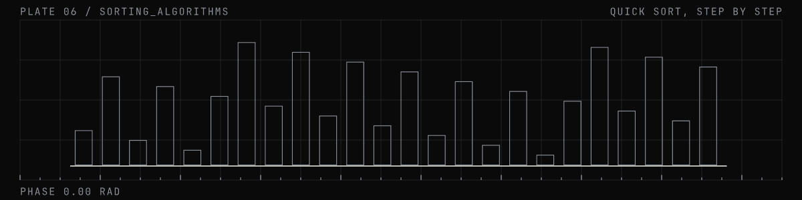
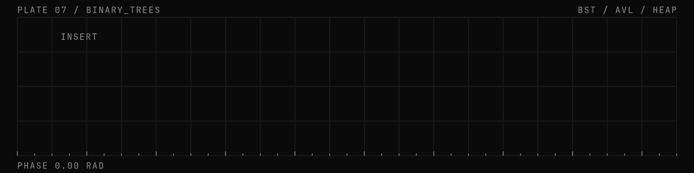
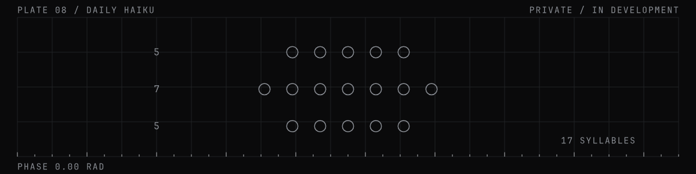
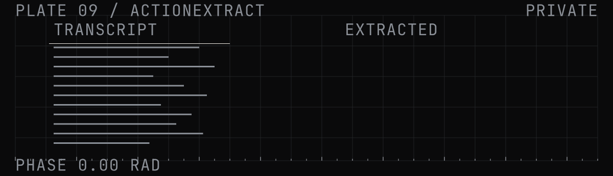

<!-- DRAFT profile README for meta-kore/meta-kore. Placeholder copy marked TODO. Not published. -->

  

I build software, intelligent systems and computational experiments, with an interest in the ideas and infrastructure that make them work. <!-- TODO: confirm positioning line -->

## 01 / Selected work

**INTELLIGENCE**

**[allowance](https://github.com/meta-kore/allowance)**

A PayPal spending wallet with rules for AI agents: each purchase is paid, held for approval, or blocked. Built for the PayPal AI Hackathon 2026.

**[kitty](https://github.com/meta-kore/kitty)**

An AI treasurer for savings circles, built on PayPal Invoicing and Payouts. Built for the PayPal AI Hackathon 2026.

**SYSTEMS**

**[tab-shelf](https://github.com/meta-kore/tab-shelf)**

A Chrome extension that saves windows of tabs to a searchable shelf and never deletes anything unless asked.

**FOUNDATIONS**

**[simple_shell](https://github.com/meta-kore/simple_shell)**

A UNIX command interpreter in C: PATH lookup, fork and exec, interactive and piped modes, built-ins. Written with a teammate.

**[monty](https://github.com/meta-kore/monty)**

An interpreter for stack and queue bytecode, written in C on a doubly linked list.

**[sorting_algorithms](https://github.com/meta-kore/sorting_algorithms)**

Eleven sorts in C that print each step.

**[binary_trees](https://github.com/meta-kore/binary_trees)**

A ladder of tree structures in C, from a single node up to AVL trees and heaps.

## 02 / Workbench

Work in progress, and the experiments behind it. Most of it lives in private repositories.

**Daily Haiku** *(private, in development)*

A mobile writing practice: one prompt a day, a live 5-7-5 syllable counter, and a short note on the words behind each prompt.

**ActionExtract** *(private, MVP)*

Meeting transcripts and minutes in; decisions and action items with owners and deadlines out. Extraction runs in the browser by default.

**This profile** 
The header and every plate above are generated from source, then rendered to loops. See [`scripts/`](scripts/).
