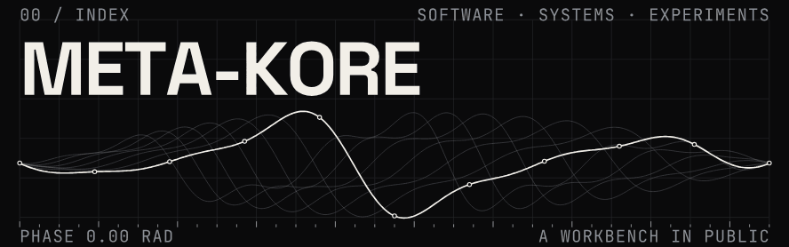

<!-- DRAFT profile README for meta-kore/meta-kore. Placeholder copy marked TODO. Not published. -->

  

I build software, intelligent systems and computational experiments, with an interest in the ideas and infrastructure that make them work. <!-- TODO: confirm positioning line -->

## 01 / Selected work

**INTELLIGENCE**

**[allowance](https://github.com/meta-kore/allowance)** 
A PayPal spending wallet with rules for AI agents: each purchase is paid, held for approval, or blocked. Built for the PayPal AI Hackathon 2026.

**[kitty](https://github.com/meta-kore/kitty)** 
An AI treasurer for savings circles, built on PayPal Invoicing and Payouts. Built for the PayPal AI Hackathon 2026.

**SYSTEMS**

**[tab-shelf](https://github.com/meta-kore/tab-shelf)** 
A Chrome extension that saves windows of tabs to a searchable shelf and never deletes anything unless asked.

## 02 / Workbench

<!-- TODO: current experiments, e.g. this profile's generative header: scripts/build-assets.py -->
Generative graphics for this profile are built from source in [`scripts/`](scripts/).

## 03 / Elsewhere

<!-- TODO: only links that are current and intentional -->
